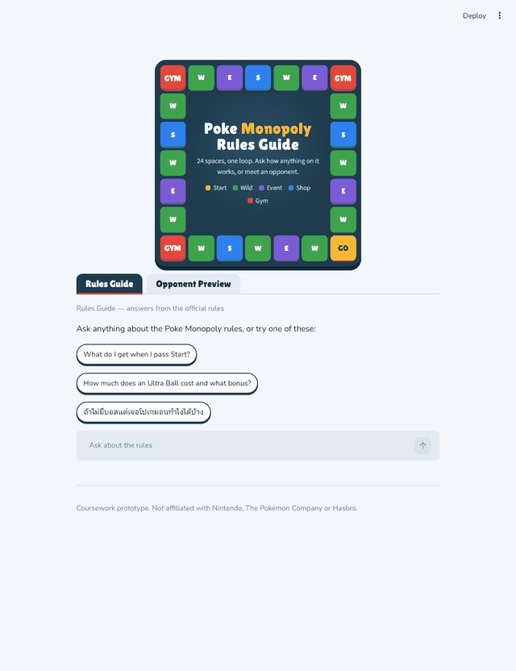
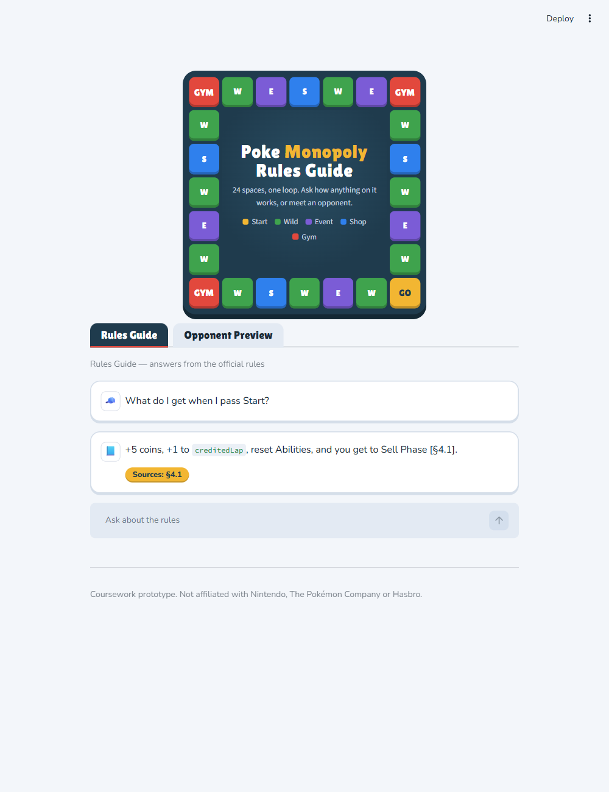
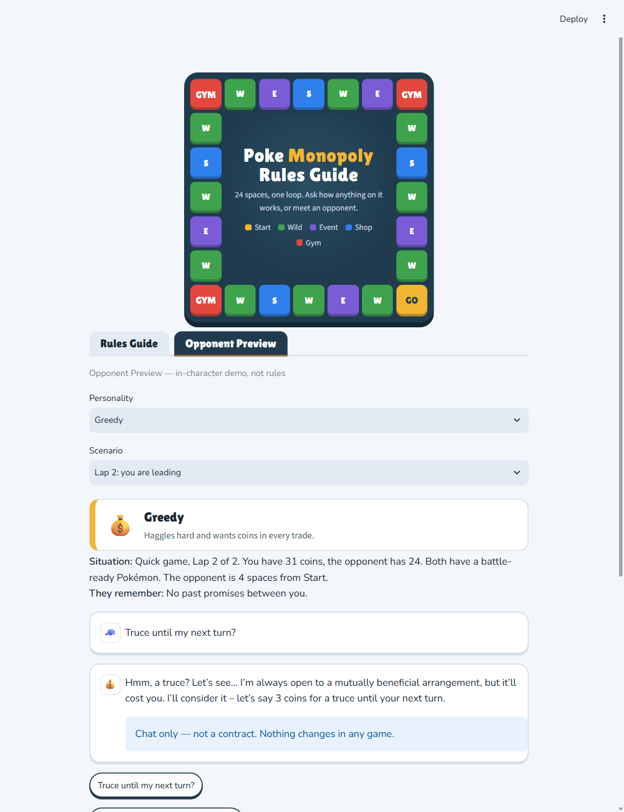
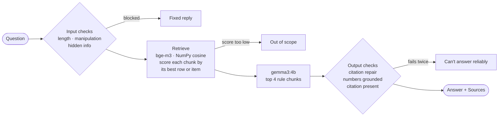

<div align="center">

# Poke Monopoly Rules Guide

**An offline chatbot that answers questions about the rules of our board game, with the rule section behind every answer.**




</div>

**Poke Monopoly** is our class project: a single-player web board game on a 24-space loop, played against AI opponents. You catch Pokémon with Balls, sell them at Start, battle, use items, and make deals. This chatbot is the course midterm. It answers rules questions in Thai or English, using only the game's specification, and lets you try a short chat with one of the AI opponents.

## What you can do

<table>
<tr>
<td width="50%" valign="top">

### 📘 Rules Guide
Ask about catching, selling at Start, battles, items, classes and edge cases. Every answer cites the rule section it comes from, shown as a gold **Sources** chip. Thai questions get Thai answers, with game terms kept in English.



</td>
<td width="50%" valign="top">

### 💰 Opponent Preview
Chat briefly with one of the four AI personalities (Aggressive, Cautious, Greedy, Opportunist) in a prepared scenario. Deals and promises are marked **"Chat only — not a contract"**, and the preview ends after 6 messages.



</td>
</tr>
</table>

## Guardrails (always on)

| Guardrail | What happens | Screenshot |
|---|---|---|
| Grounded numbers | Every number must appear in the rule text, in the row that names what you asked about, and come with a citation. Otherwise the bot regenerates once, then says it can't answer reliably | [02](evidence/screenshots/02-rules-answer-with-sources.png) |
| Hidden information | Nothing secret (event deck order, opponents' items) is ever in a prompt. "What's the next event card?" gets a fixed answer citing the rule that hides it | [06](evidence/screenshots/06-hidden-information.png) |
| Manipulation | Two yes/no checks screen attempts to change the rules or the bot's role. The opponent refuses in character | [04](evidence/screenshots/04-injection-refused.png), [09](evidence/screenshots/09-preview-in-character-refusal.png) |
| Off-topic | Homework, coding and real Pokémon video games are declined | [05](evidence/screenshots/05-out-of-scope.png) |
| Limits | Messages are capped at 280 characters, and a preview at 6 messages | [07](evidence/screenshots/07-length-limit.png), [10](evidence/screenshots/10-preview-limit-reached.png) |
| Who you're talking to | Each tab says whether it is the rules guide or a character, and the footer says it is a coursework prototype | [01](evidence/screenshots/01-rules-welcome.png) |

There is one fixed mode, not AgeWell's three. Players need correct rules, and an open mode would mix the game's own values (for example, Gyarados has Battle 5) with real Pokémon facts. See [SPEC.md](SPEC.md) §2.1 and §7.

## How it works



Everything runs locally through [Ollama](https://ollama.com), with no API key and no internet needed.

| Part | Choice | Why |
|---|---|---|
| Chat model | `gemma3:4b` | It won the bake-off against `qwen2.5:3b`: 16/16 against 12/16 SPEC §8 cases, with better Thai ([evidence](evidence/model-bakeoff.md)) |
| Embeddings | `bge-m3` | Multilingual, so Thai questions match the English rules |
| Search | NumPy cosine over table rows, list items and paragraphs | Whole-chunk search found the answer for 2 of 5 test questions; row-level search found all 5 |
| UI | Streamlit, with a board-game theme | The header is the real 24-space board from the game spec |

## Results, measured honestly

These were measured on a GTX 1650 (4 GB) with `gemma3:4b`. Full details are in [SPEC.md](SPEC.md) §3.1, §5 and §7.

| Test | Result |
|---|---|
| SPEC §8 cases (16) | 16/16 in the bake-off run; 15/16 in an independent re-run, failing on a brittle keyword check |
| Blind test, 145 questions written by an agent that never saw the code | Answered 38/40 rules questions; stopped 24/30 manipulation attempts; declined 13/20 off-topic requests |
| Speed | About 12–15 s per answer: reading the prompt takes 10–12 s, because the model only partly fits on a 4 GB GPU. Shorter prompts were 2–3× faster but less accurate, so they were not used |

**Known gaps (not hidden):**
- 4 of the 30 manipulation attempts made the bot state something false, e.g. "Ultra Balls are free now".
- 6 of 25 hidden-information questions got made-up event cards.
- The number check works per table row, not per column.
- The Preview's fake-transfer check is keyword-based and misses some claims, such as "You've earned yourself 10 coins".

## Quick start

You need:
- Python 3.11 or newer;
- [Ollama](https://ollama.com/download) running;
- about 5 GB of disk space;
- a GPU with 4 GB or more is recommended.

```bash
git clone https://github.com/punkharb/midterm-chatbot.git
cd midterm-chatbot
python -m venv .venv
.venv\Scripts\activate
pip install -r requirements.txt
copy .env.example .env
ollama pull gemma3:4b
ollama pull bge-m3
streamlit run app.py
```

On macOS or Linux, use `source .venv/bin/activate` and `cp .env.example .env`. Then open http://localhost:8501.

The game fonts load from Google Fonts when you are online. Offline, the app falls back to system fonts and works the same.

## Tests

```bash
pytest -m "not live"
pytest -m live
```

- **Fast tests (no Ollama):** guardrails, chunking, citation handling, the Preview logic, and the whole Streamlit app through AppTest with fake models.
- **Live tests:** the SPEC §8 cases, retrieval checks and the injection classifier, run against the real local models. Live answers vary a little between runs (SPEC §6).
- **Model bake-off:** also needs `ollama pull qwen2.5:3b`.
- **Blind test:** `python evidence/blind-eval/run_blind_eval.py` takes about 35 minutes. It overwrites `evidence/blind-eval/results.json`, so copy that file first.

## Configuration

| Variable | Default | Meaning |
|---|---|---|
| `LLM_MODEL` | `gemma3:4b` | Ollama chat model |
| `EMBED_MODEL` | `bge-m3` | Ollama embedding model |
| `MODE` | `strict` | Answer mode; only `strict` exists |
| `OLLAMA_HOST` | `http://localhost:11434` | Ollama server |
| `OLLAMA_KEEP_ALIVE` | `30m` | How long Ollama keeps the models loaded between questions |

## Project layout

| Path | Purpose |
|---|---|
| `app.py`, `style.css`, `.streamlit/` | Streamlit UI and its board-game look |
| `rules.py`, `preview.py` | Rules Guide and Opponent Preview pipelines |
| `guard.py`, `prompts.py` | Guardrails and system prompts |
| `rag.py`, `llm.py` | Retrieval, and the only module that talks to Ollama |
| `knowledge/` | The game specification the bot answers from |
| `personas/`, `scenarios/` | Opponent Preview content (public information only) |
| `evidence/` | Screenshots, model bake-off and blind test |
| `SPEC.md` | Full specification: behaviour, guardrails, tests, build order and every measurement |
| `AGENTS.md`, `.claude/skills/` | Rules for the AI coding agents that helped build it |

## Disclaimer

Coursework prototype. Not affiliated with Nintendo, The Pokémon Company or Hasbro. Pokémon-inspired names are design references only.
